<p align="center">
  
</p>

# Omazone

[**Download Windows app: latest development build**](https://github.com/marrabld/omazone/releases/download/development/Omazone-windows-x64.zip)
 · [Build details and checksums](https://github.com/marrabld/omazone/releases/tag/development)
 · [Numbered releases](https://github.com/marrabld/omazone/releases)

Omazone is a free, GPLv3 desktop mastering app for home musicians. Match a
reference, shape your mix with EQ and dynamics, compare changes at matched
loudness, and export the full processing chain. No paid mastering suite required.

The plots show what is measured, what correction is requested, and what the
processing actually does. Omazone is under active development, with musicians
and developers helping through listening reports, code and documentation.

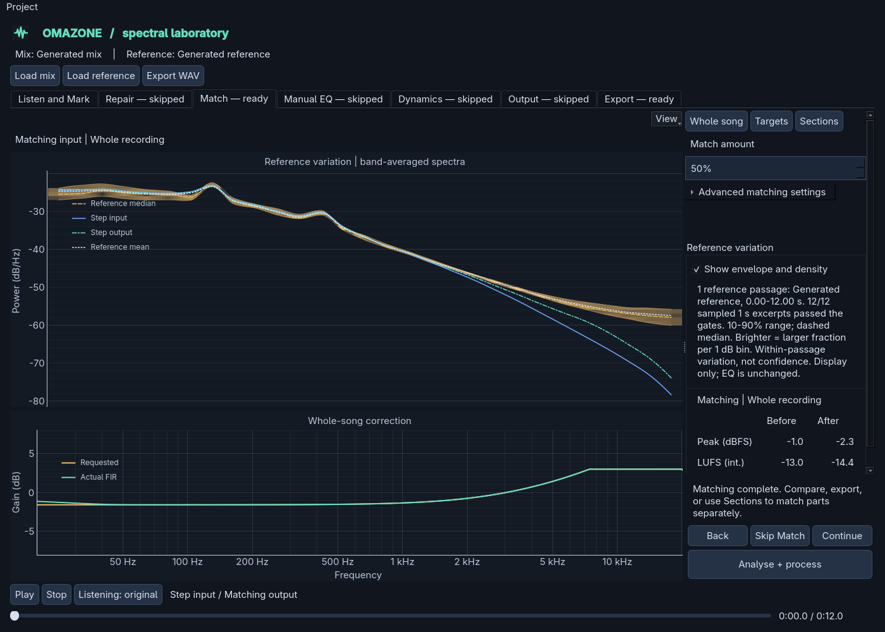

## Main features

### Reference matching you can inspect

- Match a whole song or give different passages their own reference targets.
  Adjust the amount, octave smoothing and boost/cut limits.
- Choose ordinary average-spectrum EQ matching or optional
  [range-aware correction](docs/range-aware-matching.md), which seeks the nearest
  supported reference boundary instead of its central curve. Ordinary matching
  remains the default; compare both by listening.
- Compare the requested correction with the actual linear-phase FIR response.
  Rendering compensates filter delay and preserves the song's length.
- See a reference's measured tonal variation with an optional percentile envelope,
  median and empirical density shading. This describes variation within the
  reference passage, not confidence, an ideal sound or a quality score.
- Capture named reference passages and save their profiles without embedding
  the recordings. References can use a different sample rate from your mix.

The envelope is a display only and does not use the correction method's
common-frequency normalisation. Ordinary reference EQ matching is unchanged. See
[reference variation](docs/reference-variation.md) for how the picture is made.

### EQ and dynamics, with isolated before/after listening

- Up to 12 draggable manual bell EQ bands, applied to the whole recording or a
  named passage with entry/exit fades.
- Independent high-pass, low-pass and notch [corrective filters](docs/filters.md).
- One downward [dynamic EQ band](docs/dynamic-eq.md) for intermittent excess in
  a frequency range, with attack/release, maximum cut and rendered gain history.
- Stereo-linked broadband compression with peak/RMS detection, or
  [three-band compression](docs/multiband.md) with draggable crossovers,
  per-band controls and gain-reduction traces. Band solo is audition-only.
- Explicit output gain and an optional final lookahead limiter, with its own A/B.

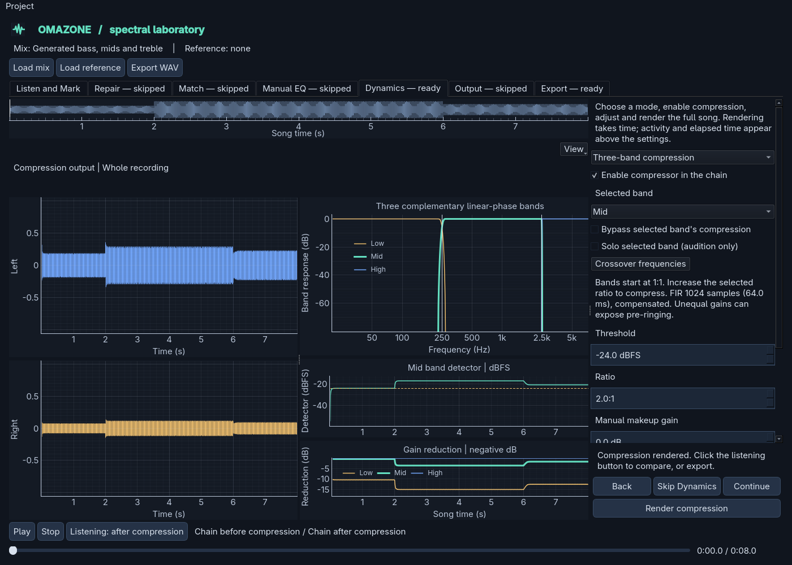

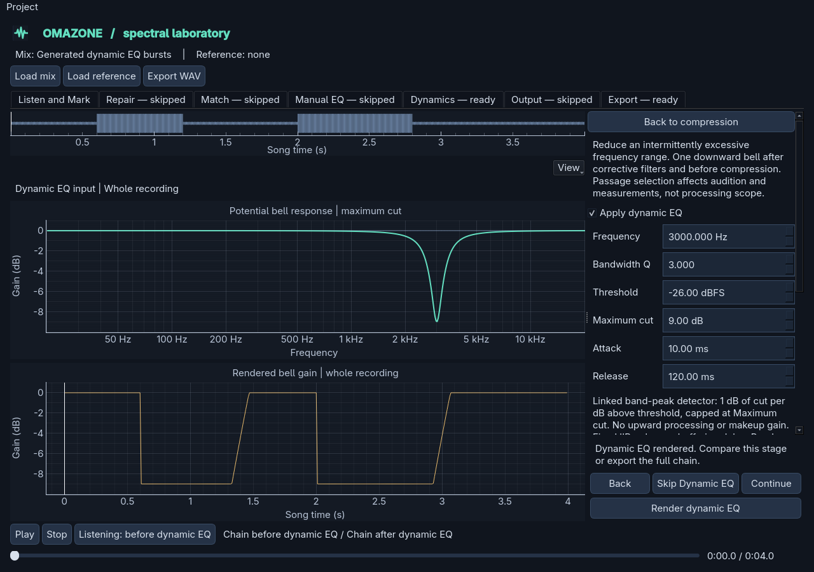

### Hear the change, keep your work

- Aligned, loudness-matched A/B compares before and after the selected stage.
  Preview gain matching never changes exported samples.
- Seek, zoom and loop passages in linked mono/stereo waveforms. Selection,
  position and loop context follow you between workflow steps.
- Inspect clipping and try selective short-gap repair, with candidate review,
  original/repaired listening and undo. Reconstruction is not guaranteed.
- Save versioned project recipes, targets and learned curves. Reopen or relink
  recordings without silently relearning matching. Downstream edits retain
  earlier processing choices and calibration.
- Choose an output device, with the preference remembered locally. An unavailable
  or incompatible device blocks playback rather than silently choosing another.

### Measure and deliver

- Compare raw before/after sample peaks and integrated LUFS for the whole recording
  or selected passage. Check final oversampled true peak before delivery.
- Import mono/stereo WAV, FLAC and AIFF. Export the complete chain as 32-bit float
  WAV by default, or 24-bit PCM with TPDF dither enabled by default.
- Keep the source rate or choose [export-only sample-rate conversion](docs/sample-rate-conversion.md)
  to 44.1, 48, 88.2 or 96 kHz, with converted sample peak, true peak and LUFS
  review. Audition stays at the source rate.
- Review every stage before export. Stale renders and over-range integer writes
  are refused; attenuation requires your consent. No silent clipping.

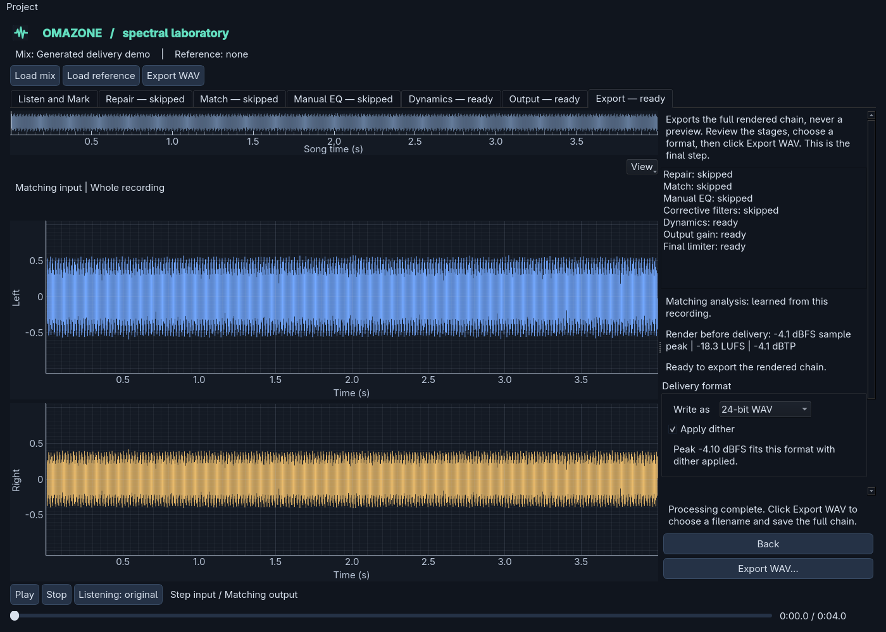

Follow the seven-step workflow, skipping processing you do not need:

**Listen and Mark → Repair → Match → Manual EQ → Dynamics → Output → Export**

Plots keep their space while detailed settings scroll. See the
[workflow guide](docs/workflow.md) for the processing steps and the
[roadmap](roadmap.md) for planned work.

The features above describe this source branch. Development downloads update
after merge and successful platform builds; numbered releases remain fixed
snapshots and may not include the latest additions.

## Quick start

Downloads for all three platforms are published together in the
[development release](https://github.com/marrabld/omazone/releases/tag/development)
after every merge into `main`. Choose the file for your system:

| Platform | Download | Install |
| --- | --- | --- |
| Windows x64 | `Omazone-windows-x64.zip` | Extract, keep `_internal` beside `Omazone.exe` |
| Apple Silicon Mac | `Omazone-macos-arm64.zip` | Extract, then move `Omazone.app` to Applications |
| Arch / Omarchy x86-64 | `Omazone-arch-x86_64.pkg.tar.zst` | `sudo pacman -U Omazone-arch-x86_64.pkg.tar.zst` |

None of these need Python installed. The Mac build targets macOS 14 or newer on
Apple Silicon; Intel Macs are not supported yet. The Arch package installs the
bundled application to `/opt/omazone` and adds an `omazone` command plus a
desktop-menu entry.

Every push or PR merge into `main` builds all three platforms, and publishes only
when each build and its bundled self-test succeed. A broken platform leaves the
last public downloads in place rather than replacing them with a partial update.
The development release is marked **pre-release** because it follows ongoing
changes. Numbered releases such as `v0.3.0` remain fixed snapshots.

Each download includes a shared `SHA256SUMS.txt` listing all three platform
archives, plus a per-platform `BUILD-INFO` file recording the exact source commit.
Verify the file you downloaded by comparing only its own hash against that list:

```powershell
# Windows
Get-FileHash .\Omazone-windows-x64.zip -Algorithm SHA256
```

```bash
# macOS and Arch: check just the archive you downloaded
grep 'macos-arm64.zip' SHA256SUMS.txt | shasum -a 256 -c -
grep 'arch-x86_64' SHA256SUMS.txt | sha256sum -c -
```

Each command prints the expected hash beside your download; the two agree only
if the file is intact.

To publish a numbered release, update the project version in a PR with
`uv version 0.4.0 --no-sync` (replace the number with your intended version).
Run `uv lock` and `uv sync --locked`, then commit both `pyproject.toml` and
`uv.lock`. Merge that PR, then push a matching tag from the new `main` commit,
such as `v0.4.0`. The tag build creates the
numbered release and attaches every platform archive, the checksum file and the
build information. Creating a release in GitHub before bumping the project
version leaves it empty: the build refuses a mismatched tag. If an empty release
with a matching tag already exists, the workflow can fill it. It never replaces
assets on an existing numbered release.

The Windows executable is unsigned, and the Mac app is not Apple-signed or
notarized. On macOS, an unnotarized app is opened by Control-clicking it,
choosing **Open**, then confirming **Open** the first time. Windows SmartScreen
shows a similar warning on first run. See [platform builds](docs/packaging.md)
for details and for what a first Mac release can and cannot guarantee.

If any platform build or its bundled self-test fails, nothing is published and the
last public downloads remain available. See the
[desktop release workflow](https://github.com/marrabld/omazone/actions/workflows/release-desktop.yml)
for progress. Development files live in Releases rather than requiring people
to find expiring Actions artifacts.

### From source

You need Git and [uv](https://docs.astral.sh/uv/getting-started/installation/).
The setup below uses Python 3.13, which uv can download if needed.

```bash
git clone https://github.com/marrabld/omazone.git
cd omazone
uv sync --python 3.13
uv run omazone
```

For an existing checkout:

```bash
uv sync --python 3.13
uv run omazone
```

To try the matching engine without recordings or a GUI, follow the
[generated-signal example](examples/README.md).

The desktop app is developed on Linux, and every packaged build is verified by
running the bundled application on the CI runner before publication. Real audio
hardware is still validated by people, so playback quality on your own machine is
worth confirming (#14). Playback uses PortAudio, which each platform bundle
includes. Choose the system default or a specific device in the app's output
device controls; the selected device must support the recording's format. See
[platform builds](docs/packaging.md) for what is and is not yet proven per
platform.

## Save and reopen your work

Use the **Project** menu:

- **Save project** (`Ctrl+S`) writes a versioned `.omazone.json` recipe.
- **Open project** (`Ctrl+O`) restores the recording references, targets, named
  regions, section assignments, accepted repairs, matching settings, stage bypass,
  selection, zoom, position, and loop context.
- **Render saved recipe** replays repairs from the original and uses stored
  matching curves, without silently relearning. Rendered audio is not stored in
  the project file. **Analyse + process** and section analysis explicitly learn
  new matching curves.
- **Stage bypass** skips repair, matching, manual EQ, corrective filters, dynamic EQ,
  compression, output gain or limiting
  while retaining that stage's choices.
- **Name current selection** adds a stable region independent of matching; the
  **Named regions** submenu returns to it.
- **Relink source/reference** locates a moved original. Sample format and a byte
  fingerprint are checked. Missing/changed recordings leave the recipe intact
  rather than quietly applying it to different audio.

Paths are relative to the project where possible. A cached reference spectrum
can still be used when its reference recording is unavailable. Moving an earlier
processing choice marks later calibration as needing analysis, but stored curves
remain available when their configuration still matches. Updating matching
settings or assignments requires explicit analysis for newly requested matching
curves. Manual EQ, corrective-filter, dynamic-EQ, compressor, output-gain and limiter edits only need rendering;
they do not relearn matching.

The implemented chain is repair -> learned matching -> manual EQ -> corrective filters
-> dynamic EQ -> broadband or three-band compressor -> output gain -> optional limiter.
Old reserved output metadata is retained; enabling an unknown
output processor fails rather than silently acting like a limiter. New, Open,
source replacement, and Close offer Save, Discard, or Cancel when the project has
unsaved changes. Audio originals are not overwritten by saving projects. Session
JSON files are ignored by Git.

## Try it on a song

### Follow the seven steps

Work runs left to right along the step bar at the top of the window:

**Listen and Mark → Repair → Match → Manual EQ → Dynamics → Output → Export**

Each step shows what it still needs, so you always know why a control is
disabled. The labels are the step's current state:

| Label | Meaning |
| --- | --- |
| `load` | No recording yet. Load a mix to begin. |
| `relink` | The saved recording has moved. Point the project at it again. |
| `repair` | Find and accept peaks to repair. |
| `review` | Check this step's settings. |
| `set up` | Configure this step. |
| `analyse` | Analysis is pending; the numbers will arrive shortly. |
| `render` | This step's audio has not been rendered since its last change. |
| `ready` | Done; the result is cached and exportable. |
| `skipped` | You passed this step without applying it. |

**Back**, **Continue**, and **Skip** move between steps without discarding your
choices. Repair, Match, Manual EQ, Dynamics, and output gain are optional, so
**Skip** is a normal outcome rather than an error; reviewing Output is the only
required step before Export. You can also click any step directly at any time,
and selection, zoom, position, and loop survive the move.

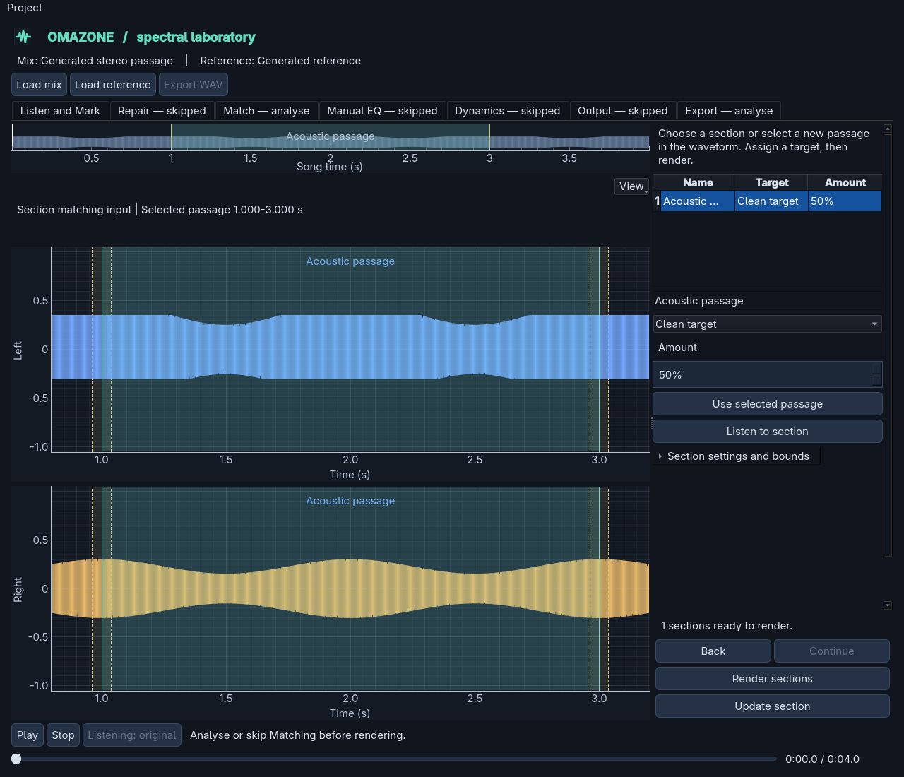

### Keep the song in view

Every tab follows the same plot-first layout: the audio stays large, task controls
live in a compact inspector, and the primary action is fixed below it. The View
menu and a single playback row replace duplicate toolbars. On narrow windows the
inspector becomes a bounded lower panel; detailed controls scroll within it rather
than reducing the plot area.

| Step or view | Inspector defaults | Optional details |
| --- | --- | --- |
| Regions | Passage name and saved-region list | Precise times and sample counts |
| Targets (Match page) | Target name and short library list | Import/export/remove and precise bounds |
| Sections (Match page) | Compact section list, target, and amount | Bounds, smoothing, limits, transition, removal |
| Clipping inspection | Result summary and candidate review | Detector/repair parameters and measurements |


The workspace stays beside a compact task inspector on wider windows, with
bounded controls below on narrow ones. Use **Waveform**, **Spectrum**, or
**Both** to inspect the same passage while working in Matching, Regions, Reference
targets, Sections, or Clipping inspection. Drag the splitter between the
viewer and controls to give either more space; inspector contents scroll rather than hiding
the song. Matching prioritises its frequency spectrum and filter response, with
compact settings beside the plots on wider windows. Other tools retain the
waveform-led workspace. In Both mode, waveform and spectra are shown side by side.


The overview shows the whole song, named passages, your selection, and
playback cursor. Selection, zoom, position, and loop survive tool changes.
On Matching it is hidden by default to give the plots more space; **View → Show
song overview** enables it. Seeking and elapsed/total time remain available.
**Step input**, **Step output**, and **Original recording** identify the visible
signal and coordinate the audition side. Waveforms use raw processing levels;
RMS-matched playback does not change the displayed/exported samples.

If output needs rendering, a yellow message says so and the input remains visible
for context. Spectrum analysis follows the selected passage, runs in a background
worker, and excludes very short selections below 0.1 seconds. Spectrum mode can
keep the time-domain overview. The label identifies input/output and scope;
the spectrum overlays show before/after tonal balance and the reference target.

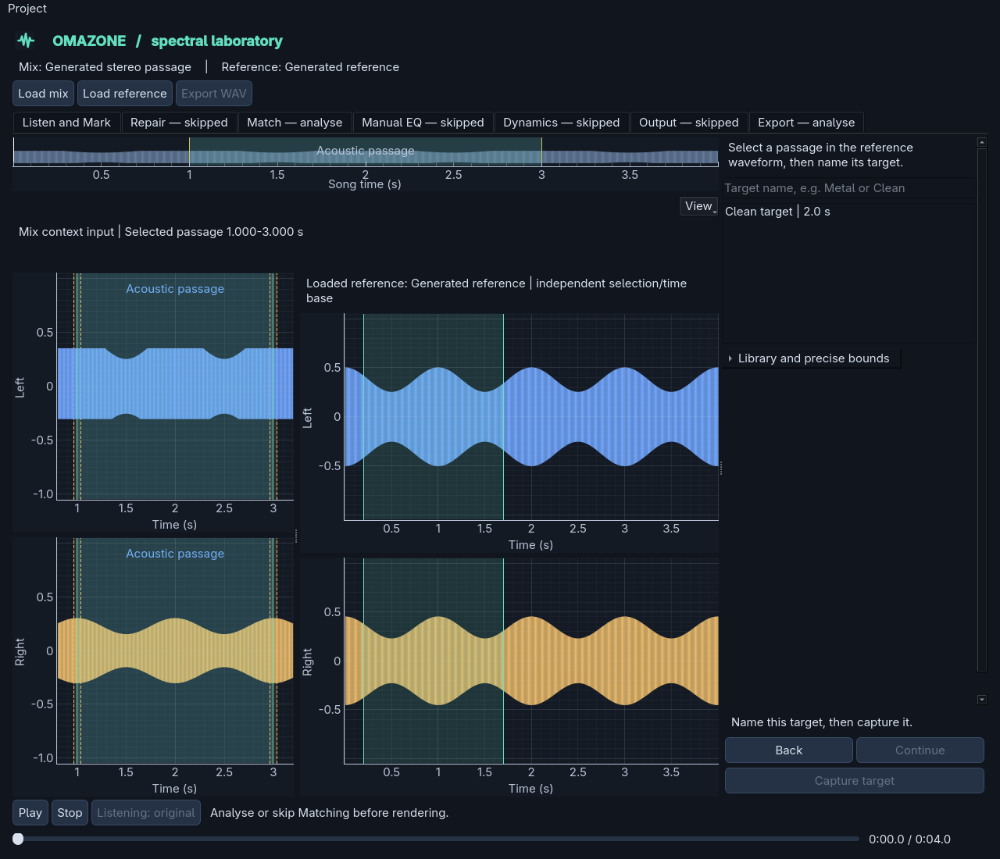

Reference capture retains your mix view and selection. The reference has an
independent waveform/time base. Selecting a library target shows its saved
spectrum; **Show loaded reference for capture** returns to the loaded reference.
Targets without their original audio remain usable. Projects save viewer mode,
signal preference, panel sizes, and the existing selection/zoom/loop context.

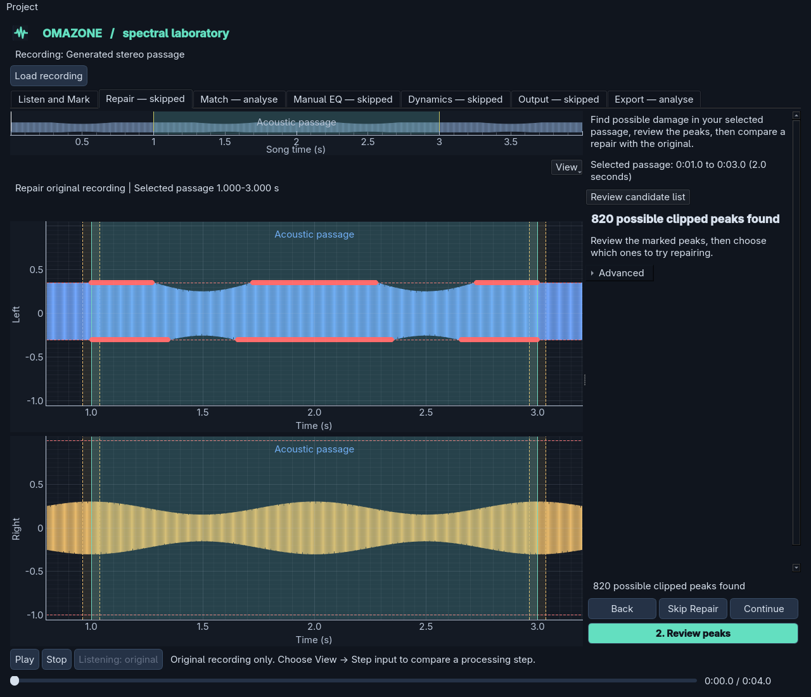

These are all now reachable through the guided workflow described below, and
each one keeps the song in view. See
[the workflow consolidation specification](docs/workflow-consolidation.md) for
the design the implementation follows.

### First matching experiment

Loading a mix or reference leaves you on the step you are working in and keeps the
selected viewer mode. A new session starts on **Listen and Mark**, so the song and
its named passages are visible first. Regions, reference capture, section
assignment, and repair start with waveforms. Each step remembers an explicitly
chosen view. On Matching, its compact **View** menu offers
Waveform/Spectrum/Both, original/input/output signals, and the optional overview.
Looping and returning to whole-recording playback are also available in this menu.
Matching starts with "Load a mix", then "Mix loaded. Add a reference",
then "Mix and reference ready". The Match step offers three pages — **Whole
song**, **Targets**, **Sections** — so you can capture named targets and match
individual parts of the song. Loading a reference does not mean you need to
capture named targets.

The plots take most of the Matching workspace. **Match amount** is shown in a
compact panel, with smoothing and gain limits under **Advanced matching settings**.
The **Reference variation** panel is below the matching settings, not on Listen
and Mark. Load a reference or capture a passage with at least four full seconds
to see **Show envelope and density**. Scroll the settings panel if needed. Older
mean-only targets need new analysis before they can show an envelope.
Choose **Matching method** to try range-aware correction. It needs new excerpt
data from both a reference and at least four full seconds of source material;
older envelope-only targets need reloading or recapturing. **Inspect proposed
curve** is under Advanced settings and does not render audio. See the
[method and its limitations](docs/range-aware-matching.md).
At narrower widths, controls become a strip below the plots. Basic matching
playback across all tools is Play/Stop, A/B, seeking, and time; looping and view
options are in **View**. The tabs and primary action bar do not scroll. **Analyse + process** stays visible
on Matching; **Render sections** stays visible on Sections. Settings may scroll
when the lower panel is small. **View → Show measurements and status** expands the footer
details when you need them. Opening a saved project still deliberately restores
its saved tool and view preferences.

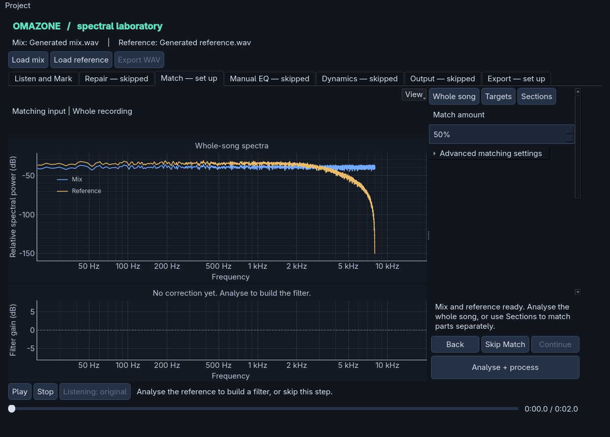

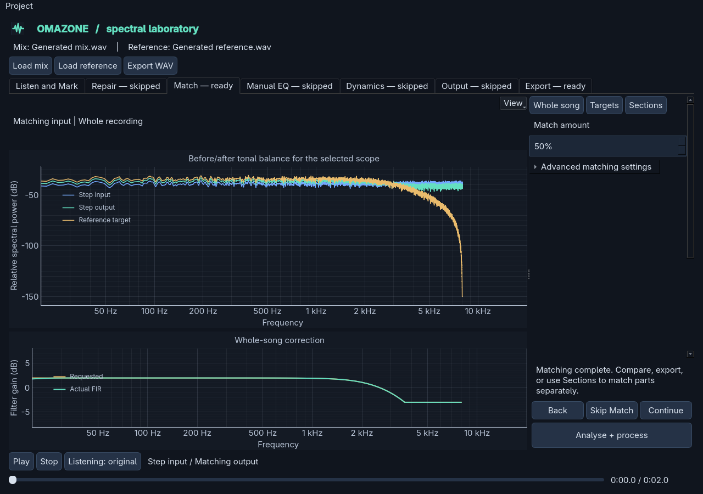

1. Load a mix and a broadly similar reference track.
2. Start with 50% amount, 0.33-octave smoothing, and 6 dB boost/cut limits.
3. Click **Analyse + process** to render the result.
4. Click **Play**, then use the listening button to switch original/processed.
5. Seek to a verse, chorus, or transient-heavy section and compare again.
6. Export when you want to use the processed file elsewhere.

Play auditions the original initially; the listening button switches to the
processed version at the same playback position. Click or drag the seek bar to
audition another section. Playback pauses during a drag and resumes on release
if it was playing. Play/Pause and Stop preserve the cursor; seek to the left edge
to restart. Pressing Play after reaching the end starts from the beginning.
The time display shows elapsed and total time. With the seek bar focused, arrow
keys move one second and Page Up/Down move ten seconds.
Switching A/B uses a 10 ms linear crossfade. Seeking fades out and back in;
pausing fades out before stopping, and resuming fades in. These preview-only
transitions never change export. See [audition transitions](docs/playback.md).
Changed settings require another render. WAV, FLAC, and AIFF mono/stereo files
are supported. Different reference and mix sample rates are supported.

## Inspect a waveform and select a region

Choose **Regions** to inspect the shared waveform. It has linked left/right plots,
or one for mono. Loading files keeps the current tool selected.
Choose Spectrum/Both without leaving your tool.
The inspector contains a passage name and saved-region list. **Name current
selection** stays fixed below it. Exact times and sample counts are under
**Precise selection bounds**.
Matching controls are on **Matching**; the response stays in the shared spectrum view.

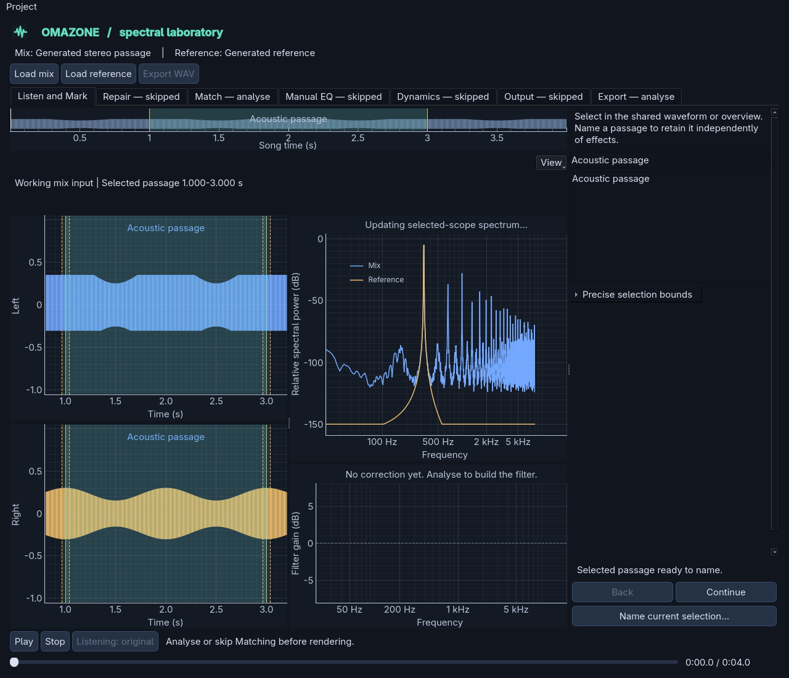

- Use the mouse wheel to zoom horizontally and drag the background to pan.
- **Shift+drag** on the background creates a selection. Drag its green edges to
  resize it, or drag the shaded region to move it. Both channels share the region.
- Expand **Precise selection bounds** to edit **Start** and **End**. Spin-box steps
  move one sample; the label shows exact sample indices and duration.
- **Select view** selects the visible time range. **Zoom selection** magnifies
  the region; **Fit song** returns to the full track; **Clear** removes it.
- Click the background to seek, or use **Seek start** to audition from the selected
  region's beginning. The white cursor follows the existing playback transport.

Selection bounds are half-open sample intervals `[start, end)`, like a NumPy
slice. Processing and export still use the whole file.
A new mix clears the selection, while changing matching controls or the reference
keeps it.

### Play and loop a selection

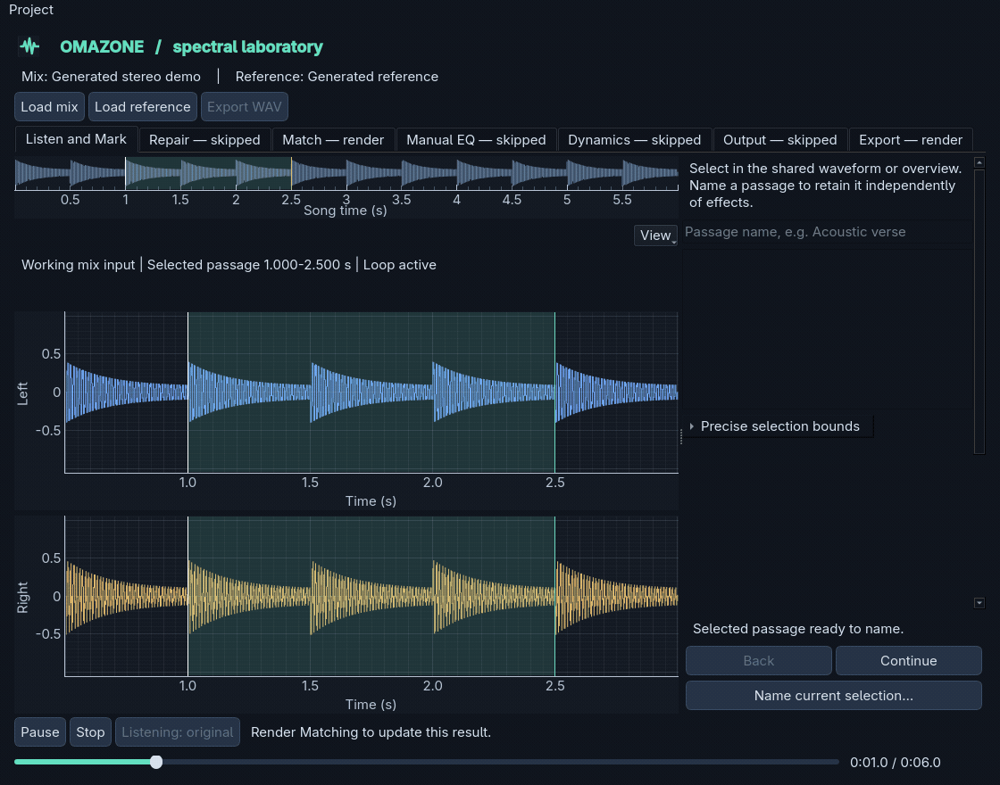

The silent demo uses generated audio and the actual playback callback with a
simulated device. Watch the white cursor wrap at the selection's end and the
listening button switch to processed. [Recreate the demo](docs/loop-demo.md).

Select a passage, then click **Play selection**. Playback starts at its beginning
and stops at its exclusive end. Enable **Loop selection** to repeat it instead.
The loop toggle prepares selected-region playback; if playback is already running,
it continues within the selected bounds. Turning looping off retains one-shot
selection mode, so playback stops at the region end.

- A/B switches keep the same sample position, including across loop boundaries.
- Play/Pause and Stop preserve the cursor and playback mode. Play after the end
  of a one-shot selection restarts at its beginning.
- Seeking inside the active region retains its mode. Seeking outside it returns
  to whole-song mode and turns looping off. **Whole song** also exits region mode.
- Editing an active selection pauses playback, then resumes after the bounds
  settle. Clearing it returns to whole-song mode; Stop cancels a pending resume.
- A new mix resets region playback and looping.

Loop wraps are sample-exact, including regions shorter than an audio callback.
There are no boundary fades yet, so mismatched endpoints can produce clicks;
choose musically sensible boundaries while transition smoothing is developed.

Wide views draw min/max buckets to preserve transients. Zooming in displays raw
samples. An overview bucket may include samples just outside the viewport edge;
zoom to sample level when inspecting an exact boundary. Peak-index construction
runs alongside file analysis in the loading worker, while redraws use a bounded
number of display points.

## Match metal and clean sections separately

Matching is not only whole-song. The Match step has three pages, chosen at the
top of its panel:

| Page | Use it for |
| --- | --- |
| **Whole song** | One correction applied to the entire recording |
| **Targets** | Capturing named reference passages |
| **Sections** | Different settings for different parts of the song |

Use **Analyse + process** on *Whole song* for a single correction everywhere. Use
**Sections** when a song contains passages with different tonal goals.
Each mix section is analysed independently against its assigned target; the
whole-song spectrum is not used to design its correction.
Its inspector shows the compact section list, name, assigned target, and amount.
Precise time bounds, smoothing, boost/cut limits, transition settings, and removal
are under **Section settings and bounds**. Add/Update and Render actions stay fixed.


1. Load a reference and open **Targets** on the Match step. Shift+drag its metal
   passage, enter a target name such as `Metal`, and click **Capture target**.
2. Select its clean passage and capture `Clean`. You can also capture targets
   from different reference files; earlier targets remain in the library.
3. Load your mix and select the metal passage in the shared waveform.
4. Open **Sections**, click **Use selected passage**, name the section, choose
   `Metal`, set its amount/smoothing/gain limits, and click **Add section**.

   With a passage already selected, Match offers **Match individual sections →**
   instead, which opens **Sections** with that passage already in the form. It
   appears only when it can work, so you need a selection and a captured target.
5. Repeat for the clean passage with the `Clean` target. Assignments cannot overlap.
6. Choose a **Transition** duration and click **Render sections**. This produces
   one complete preview and exportable file, keeping the original duration.
7. Select a table row and use **Inspect EQ** under section settings to view its
   correction. **Listen to section** uses the existing transport; enable looping
   from **View** and switch original/processed to compare it repeatedly.

To change an assignment, select its row, edit the fields, and click **Update
section**. **Inspect EQ** and **Render sections** also apply pending edits to the
selected row. Edits invalidate the old preview and export until you render again.
**Analyse + process** on the *Whole song* page still performs whole-song
matching; section settings live in the section table and editor.

Coloured named regions appear on the mix waveform. Dashed yellow windows show
where neighbouring filtered signals, or a filter and the original audio, blend.
Unassigned samples outside these windows stay unchanged.

The transition setting is the requested full window duration, centred on each
boundary. Windows shorten automatically when neighbouring sections or gaps are
small, so they cannot overlap. The summary lists their effective durations.
At file edges no transition is added. Setting the duration to zero gives a hard
switch; even a nonzero fade can produce an audible tonal change.

Rendering uses surrounding audio context for each linear-phase FIR, compensates
delay before mixing paths, and uses complementary raised-cosine amplitude weights.
Identical paths therefore do not receive an equal-power crossfade gain boost.

**Save targets / Load targets** store versioned JSON spectral profiles and passage
metadata, not the recordings. Imports merge into the library; colliding IDs become
new targets so existing assignments are preserved. References may use a different
sample rate from the mix. Choose at least 0.1 seconds of non-silent material;
longer representative passages generally make better tonal targets.

Section assignments and settings are saved in the project recipe. Loading a new
mix starts a new session but retains the captured target library. Preview level
matching uses whole-file [loudness](docs/loudness.md), not separate per-section
normalisation. Section matching controls tonal balance, not dynamics or
vocal/instrument balance.

## Try clipping repair

The clipping screen starts with a guided workflow. Numerical controls are hidden
under **Advanced**, and unrelated mastering controls
are hidden while you inspect or audition a repair.

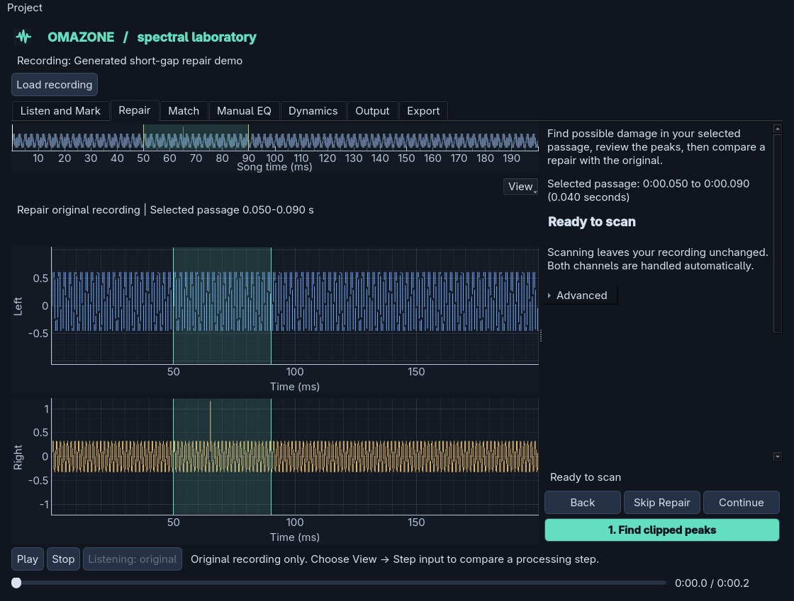

1. Select the affected passage in the shared waveform and open **Clipping inspection**.
2. Click **Find clipped peaks**. Left/right channels are scanned with separate
   suggested levels; scanning does not change your recording.
3. Click **Review peaks**. Inspect a peak if unsure, then check the ones you want
   to try repairing. **Include shown peaks** checks the displayed candidates.
4. Click **Try repair**. Peaks the algorithm cannot reconstruct are kept unchanged.
5. Click **Listen to repair** to loop the selected passage, then use the listening
   button below to switch between original and repaired audio.
6. **Undo repair** restores the original input. **Save repaired audio** exports
   the raw repaired signal without preview gain matching or subsequent EQ.

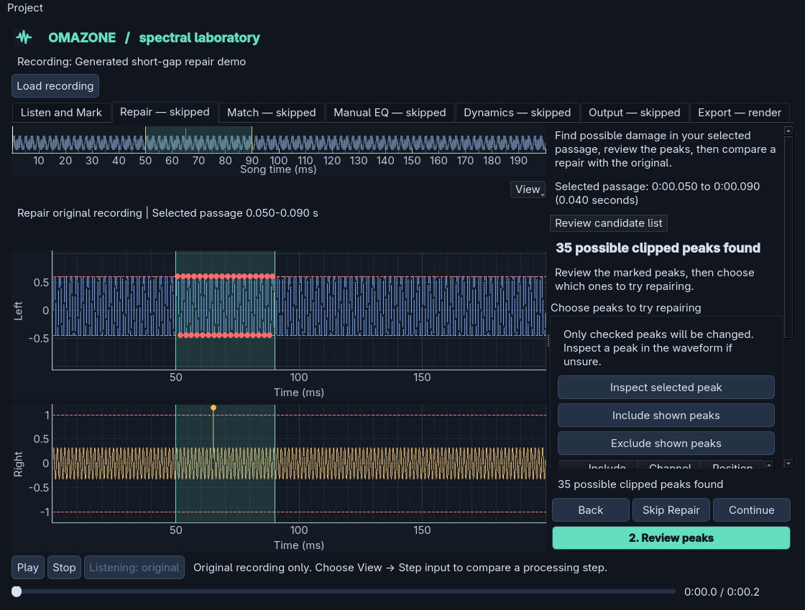

Red waveform markers show possible flattened peaks; orange markers show values
above full scale. Green overlays show reconstructed samples. These generated-audio
screenshots illustrate a clipped left channel and an over-range right channel.

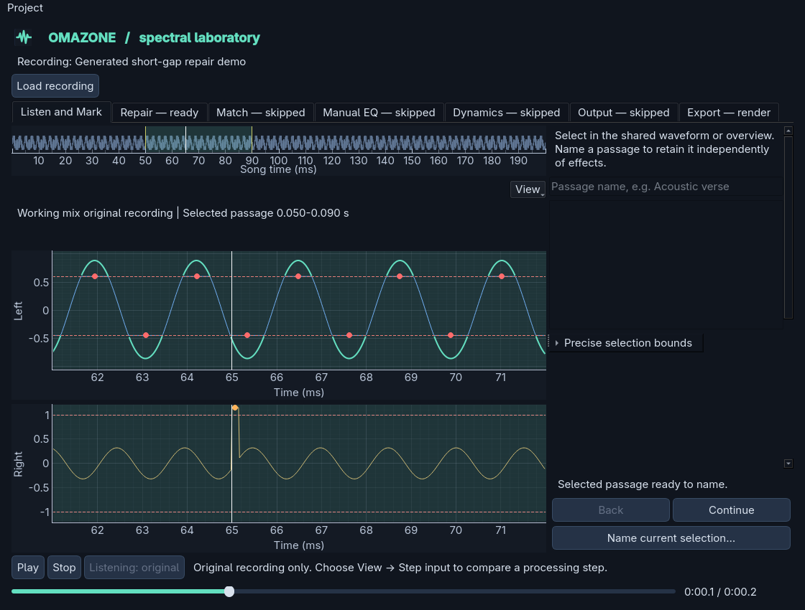

If no clear peaks are found, the screen says so and leaves repair unavailable.
A clipped instrument mixed with other sounds may no longer have visible flat
peaks. Use the isolated recording when available. A float signal above full scale
can instead be a volume-level problem, so those samples are not automatically
treated as missing peaks.

The recording stays unchanged until you explicitly try a repair. Guessed levels
and flat-looking peaks are not proof of damage; clean low-frequency or synthesised
signals can produce false positives. Compare by listening and undo a poor result.

For manual scanning, channel/threshold controls, exact measurements, and repair
parameters, expand **Advanced**. See
[the inspection guide](docs/clipping-inspection.md) and
[the reconstruction algorithm](docs/declipping.md).

### Repair behaviour

The original recording stays in memory unchanged. Whole-song matching and section
matching use the repaired input after a successful repair, and their previous
renders become stale. Mastering audition uses **Input / mastered**; when repair is
active, its input side is the repaired signal. **Original / repaired** remains a
separate comparison. Mastering export defaults to 32-bit float, with optional 24-bit PCM delivery.
Repair saving uses 64-bit float WAV to retain the internal sample precision.

Repair is an offline cubic-Hermite baseline using the intact endpoint samples and
slopes fitted to surrounding audio. Only checked intervals that pass the checks
are changed, without a broad section crossfade. Long runs, insufficient or damaged
context, unsupported slopes, and inconsistent or excessive reconstructions are
skipped. Samples outside successful intervals remain exactly unchanged internally.
Restored peaks may exceed full scale; repair export preserves them rather than
silently limiting or normalising.

Each successful **Try repair** is computed from the original. It updates repairs
inside that selection while retaining repairs elsewhere. A selection that cuts an
existing repaired interval must be expanded to include it. If no interval passes,
the previous repair remains active. The table
shows at most 500 intervals, so **Include shown peaks** covers only displayed candidates.
Use a short representative passage for this first version. Loading a new mix
clears repair state; save the project to retain the operation recipe across restarts.

This does not guarantee recovery. Tests show improvement on deliberately clipped
sine/harmonic examples, but an intentionally flat-topped waveform can be made worse.
Compare by listening, especially on guitar attacks, and use the isolated guitar
recording when available. See [the algorithm and experiment](docs/declipping.md).

## Correct a named passage with manual EQ

Manual EQ adds up to 12 bell bands **after** whole-song or section matching. It does not
erase repairs, targets, section assignments, or learned matching curves. The
original source file remains unchanged.

1. Do reference matching, if wanted. Manual EQ also works without a reference when
   matching mode is `none`, or when matching is deliberately bypassed.
2. For a local correction, select the passage in **Regions**, name it, and save it
   with **Name current selection**. Matching sections already have named regions.
3. Open **Manual EQ** and choose the passage under **Apply to**, or **Whole recording**.
   All bands share this scope and its fade duration.
4. Click the graph to add a band, or use **Add band**. Drag a coloured dot left/right
   for frequency and up/down for gain. Scroll over the dot for width (Q). The
   inspector offers exact values for the selected band. Start with a small cut,
   such as -2 dB; new bands start at zero gain.
5. Add more bands for independent corrections. Select a dot or list entry to
   edit it; duplicate, remove, or bypass individual bands. Lower Q affects a
   broader range; higher Q is narrower. **Region transition** sets the shared
   entry/exit fade, initially 75 ms.
6. Click **Apply EQ and render** to render the saved chain without relearning matching.
   Playback switches to this step automatically, and the listening button becomes
   **before EQ**. It may already be active, so you can click **Play** right away.
7. Use the listening button to switch **before EQ / after EQ**. Both include the same
   earlier repair and matching work, so you hear only the manual EQ difference.
   **Loop and compare this step** also selects the region and enables looping.
8. **Export WAV** saves the full chain, not just the audition pair.

To hear the untouched recording instead, choose **View → Original recording**. That
freezes playback on the original and disables comparison, which is why the listening
button then reads "Listening: original"; choose **View → Step input** to come back.

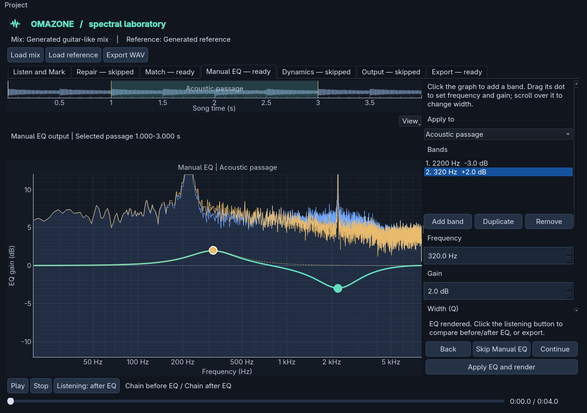

For high-pass, low-pass and notch filters, open **Corrective filters** inside
Manual EQ. These apply to the whole recording after bell EQ and before dynamics,
with independent bypass and filter-only A/B. See the
[filter controls, response screenshot and phase tradeoffs](docs/filters.md).

**View → Both** shows the region and spectrum together. Purple dashed windows mark
entry/exit fades inside the selected region. They shorten if the passage is too
short for the requested duration. File edges do not need a fade to adjacent dry
audio. Samples outside the region remain exactly unchanged by this EQ stage.

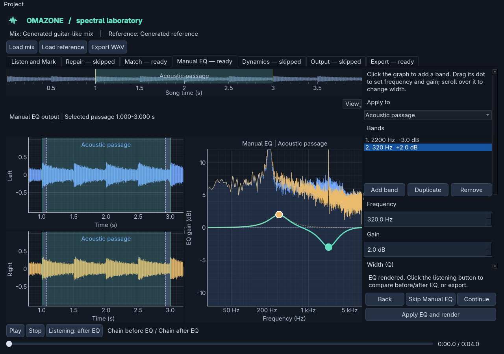

Uncheck **Apply this EQ** to bypass all bands without losing settings. **Reset selected band to neutral**
sets its gain to zero. Project save/open retains the bands, named region, Q, fade, and
bypass state. Editing EQ makes the final preview/export stale, while earlier
matching previews and calibration remain available. Rendering reuses valid prefixes.

The live background spectrum follows the playhead while listening. The analyzer
is auto-scaled; the left dB axis measures EQ gain, not the spectrum's absolute level.
Band settings are fixed during rendering. Region amount is smoothly blended
between filtered and dry paths, not a free-form automation lane. The EQ is
causal and changes phase around the band, with shared stereo coefficients and no
lookahead. It is not compression or limiting; boosts can exceed full scale.
Preview gain matching/headroom is not exported. See [the chain and EQ design](docs/manual-eq.md).

## Control whole-mix dynamics

Compression follows manual EQ, corrective filters and the independent dynamic EQ
stage, and applies to the whole recording. It can work without a reference or EQ.
Choose broadband or three-band mode in **Dynamics**. The steps below describe
broadband compression; see [three-band compression](docs/multiband.md) for the
crossover and per-band controls. Open **Dynamics > Dynamic EQ...** for the
separate [dynamic EQ stage](docs/dynamic-eq.md).

1. Open **Compression**, set **Threshold** around the louder passages and start
   with a modest **Ratio**, such as 2:1. The graph shows the input-to-output level
   curve; the dashed diagonal is unchanged level.
2. Check **Apply compressor** and click **Apply compression and render**. The
   detector and actual gain-reduction histories appear below the curve. A lower
   threshold or higher ratio usually means more reduction.
3. **Timing, knee and detector** holds attack, release, soft knee and peak/RMS
   detector selection. Attack controls how quickly the linked envelope rises;
   release controls how it falls. Both stereo channels receive the same gain.
4. Rendering switches playback to this step, so the listening button becomes
   **before compression**; click it for **after compression**. Both sides include
   the previous repair, matching and manual EQ steps. **Loop and compare
   compression** also selects the region and enables looping. The inspector shows
   maximum gain reduction and output sample peak.
5. Add **Manual makeup gain** only if wanted. It is exported; preview-only
   level matching is not. Check peaks before **Export WAV**.

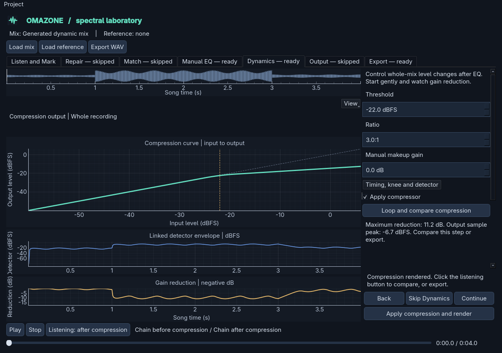

**View → Both** keeps the waveform next to the compression graphs:

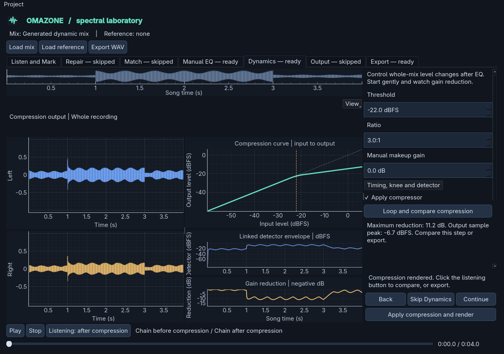

You can bypass compression without losing its saved settings. Changing compression
only invalidates its final preview/export; the EQ and learned matching are kept.
This causal compressor has no lookahead or limiter and may exceed 0 dBFS after
manual makeup. See [the compressor design](docs/compressor.md).

## Check the final output

The Output step sits after dynamics. It shows three rows: the original recording,
the signal before output gain, and the final float-WAV export. Each row carries
three measurements that answer different questions:

| Measurement | Reads | Above 0 dB means |
| --- | --- | --- |
| Sample peak (dBFS) | The largest sample in the file | Float samples exceed full scale |
| True peak (dBTP) | The largest sample after reconstruction | It will clip on playback |
| Loudness (LUFS) | A gated average weighted by perception | Nothing; it is not a limit |

Red means that row exceeds full scale.

1. Open **Output**. If the original row is already red, it came from the source.
   If **Before gain** first turns red, earlier processing introduced the overload.
2. Set **Output gain**, for example -6 dB, and click **Render output**.
   Changing a nonzero gain enables the stage. A new project skips it by default.
3. Check the measurements again and use **Loop and compare output gain**
   for aligned before/after listening. A/B level matching only affects playback;
    export contains your chosen gain and any enabled final limiter.

For final peak protection, check **Enable final limiter**, start with a **-1 dBTP**
ceiling, and click **Render output**. Choose **Compare final limiter** for its own
before/after pair. The reduction trace includes any reported, whole-file true-peak
safety attenuation. Lookahead is compensated and export keeps the original length.
Output gain and the limiter start bypassed and keep independent settings. See
[final limiting](docs/limiter.md) for the method and measurement tolerances.

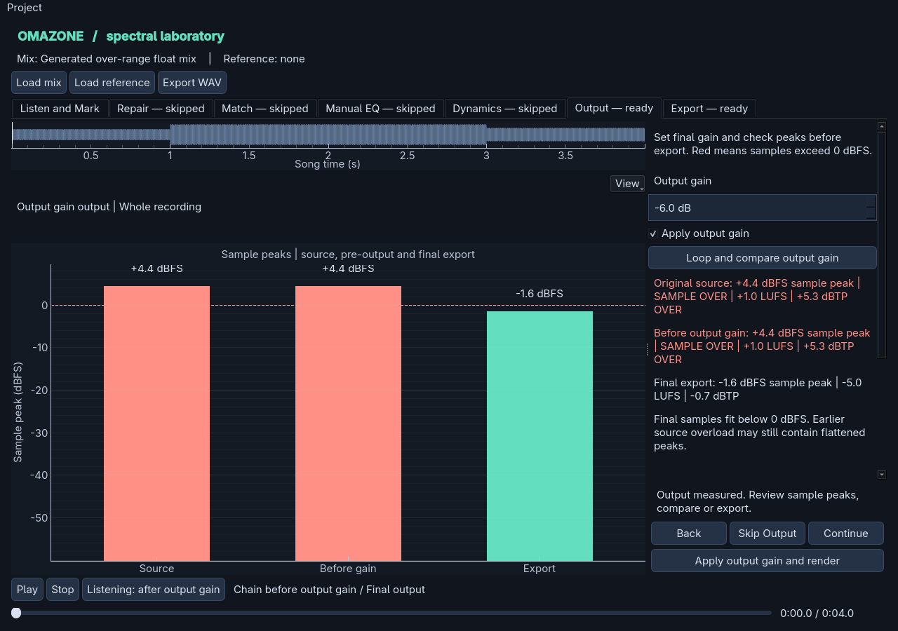

**True peak is the one to watch before delivery.** A file can sit at exactly
0 dBFS sample peak and still clip on playback, because the converter rebuilds
the waveform between samples. Gain and meters alone do not prevent it. The final
limiter is optional; when bypassed, a reading above 0 dBTP remains an overload
warning. See [true peak](docs/true-peak.md).

**View → Both** places the waveform beside the peak display:

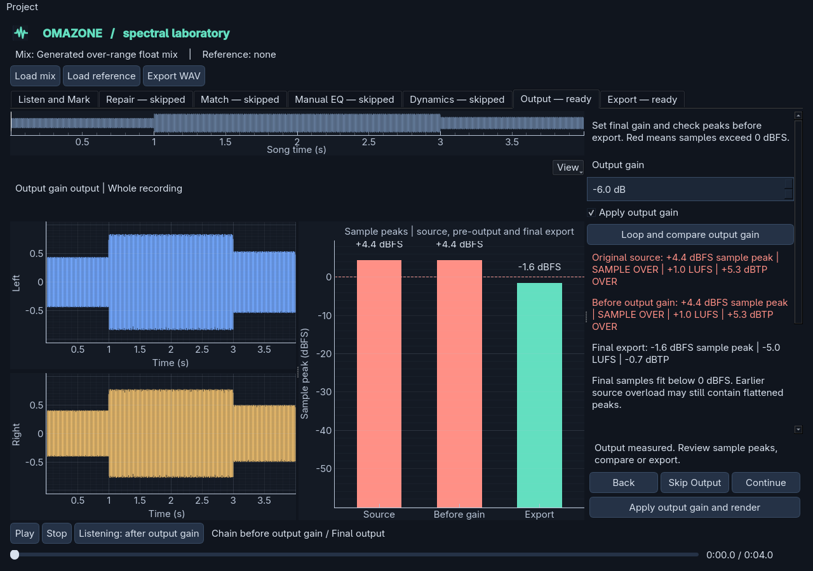

Attenuating floating-point samples above 0 dBFS can restore headroom. It cannot
recover the missing shape of peaks flattened before import, and neither true
peak nor output gain limits them. See
[output gain and peak handling](docs/output-gain.md).

## Deliver the file

The Export step closes the workflow. It writes the full-chain render, never a
preview, and lists every stage with its current state, so the file you hand over
matches the choices in the project. Stages you skipped are listed as skipped
rather than quietly dropped.

Export is also the honest place to discover unfinished work. If a stage still
needs rendering or analysis, the review says which one and offers to take you
there; it will not quietly export a stale or partial chain.

1. Open **Export** and check the summary of what will be rendered.
2. Choose a delivery format. The panel shows whether the current peak fits it.
3. Click **Export WAV…** and choose where to write the file.
4. Reopen the exported file if you want to confirm it against the original.

32-bit float is the default and preserves samples above 0 dBFS, though playback
can still clip. Choose 24-bit when the recipient requests it; it is dithered by default and Omazone
refuses to write an integer file that would clip. See
[delivery formats, headroom and dither](docs/delivery.md).

**Sample rate** defaults to the source rate. Optional conversion is applied
before quantisation/dither, with a separate final-rate review and no hidden
attenuation or limiting. Delivery preferences are saved without changing
processing or audition. See [supported rates and conversion](docs/sample-rate-conversion.md).


Export writes from the recipe, so reopening the project later re-renders rather
than reusing a baked intermediate. See
[the workflow specification](docs/workflow.md) for the full journey.

## Current limitations

The interface shows sample peaks, integrated LUFS and oversampled true peaks;
see [loudness](docs/loudness.md) and [true peak](docs/true-peak.md). Meters alone
do not prevent clipping. Optional [limiting](docs/limiter.md) controls final peaks,
but cannot repair damage in the source or guarantee a later lossy encode.
Preview is loudness-matched, with common
attenuation to provide headroom. LUFS is a good model of average perceived
loudness rather than of every listener, so A/B matching remains approximate.
A/B switches are crossfaded; arbitrary loop boundaries are not smoothed.
Measuring integrated loudness and true peaks adds a few seconds to rendering a
six-minute song, in the background.

Mastering exports contain the full chain, without preview attenuation. Float
files can exceed 0 dBFS when limiting is bypassed; integer targets cannot, so
Export asks you to attenuate first rather than clipping. Dither is applied once,
only when quantising to 24-bit. Delay is compensated and the output
retains the input length. The complete matching-FIR
convolution tail is available through its processor API, but file rendering trims it.

Audio files and outputs are ignored by version control. Dependencies are pinned
in `uv.lock`. Qt uses the `PySide6-Essentials` package: the app only needs
QtCore/QtGui/QtWidgets, and skipping the Addons wheel roughly halves the install
and packaged download. `omazone/__init__.py` restores the package `__version__`
that pyqtgraph expects.

## How it works

1. Welch analysis averages power spectra across time and channels independently.
   It does not sum stereo channels before analysis.
2. Source and reference spectra are interpolated onto a logarithmic frequency grid.
3. Their dB difference is centred to remove an overall level offset. This also
   removes the constant offset from different spectral bin widths.
4. Gaussian smoothing on the log grid reduces narrow, note-specific corrections.
   The smoothing control is the Gaussian standard deviation in octaves.
5. Boost/cut limits are applied, then scaled by the match amount. At 50% amount,
   a 6 dB maximum boost produces at most a 3 dB requested boost.
6. `scipy.signal.firwin2` designs a 2049-tap linear-phase FIR. The actual response
   can differ from the requested curve, especially at low frequencies.
7. A stateful FFT overlap-add processor renders blocks, flushes its tail, and
   the renderer compensates the FIR delay.

Analysis uses the whole file, including quiet passages. Matching an average
spectrum changes tonal balance; it cannot reproduce the reference's arrangement,
vocal balance, dynamics, or loudness. Treat the curve as an experiment rather than
a mastering verdict. Silence is rejected rather than used as a matching target.

## Code map

- `src/omazone/engine.py`: analysis, filter design, processor, offline render.
- `src/omazone/gui.py`: Qt interface, worker thread, preview playback, export.
- `src/omazone/waveform.py`: peak index and GUI-independent sample-region model.
- `src/omazone/waveform_view.py`: linked waveform plots, selection, zoom, and seeking.
- `src/omazone/playback.py`: GUI-independent sample cursor and selected-region buffer filling.
- `src/omazone/sections.py`: named profiles, validation, transition planning, and contextual rendering.
- `src/omazone/section_view.py`: reference capture, profile library, and section-assignment editor.
- `src/omazone/clipping.py`: per-channel plateau candidates, over-range intervals, and threshold hints.
- `src/omazone/clipping_view.py`: diagnostics controls, results table, and interval navigation.
- `src/omazone/declipping.py`: selective Hermite reconstruction, intact-context checks, and rejected intervals.
- `src/omazone/project.py`: versioned recipes, source verification, calibration signatures, and repair replay.
- `src/omazone/project_controller.py`: project menus, save/load/relink, stage bypass, and saved rendering.
- `src/omazone/workspace.py`: persistent viewer/overview, reference companion, signal labels, and background spectra.
- `src/omazone/pipeline.py`: fixed repair/matching/EQ/compression/output chain and prefix caches.
- `src/omazone/manual_eq.py`: causal bell processor, region fades, and frequency response.
- `src/omazone/manual_eq_view.py`: band controls and before/after-this-step audition.
- `src/omazone/eq_canvas.py`: interactive band graph and overlaid spectrum.
- `src/omazone/compressor.py`: linked detector, static curve, block processing and diagnostics.
- `src/omazone/compressor_view.py`: compressor controls, level curve and gain history.
- `src/omazone/output_gain.py`: explicit final gain and raw sample peaks.
- `src/omazone/output_view.py`: source/pre-output/final readings and output-gain A/B.
- `tests/test_engine.py`: identity, streaming equivalence, spectral improvement,
  stereo preservation, gain limits, and preview headroom.
- `tests/test_gui.py`: render/export workflow, seeking, and shared A/B cursor.
- `tests/test_waveform.py`: preserved peaks, raw-sample zoom, and region bounds.
- `tests/test_playback.py`: exact loop wraps, short regions, one-shot endings, and A/B alignment.
- `tests/test_sections.py`: profile validation, section context, dry gaps, stereo, and transition alignment.
- `tests/test_clipping.py`: asymmetric/scaled clipping, rails, overloads, and documented detection limits.
- `tests/test_declipping.py`: repair accuracy, exact masks, rejection cases, and a known worsening case.
- `roadmap.md`: planned processing modules, priorities, and contribution ideas.
- `branding/`: the application mark. The SVGs are the source of truth; run
  `uv run python tools/build_icons.py` to regenerate every platform format from
  them. Edit the SVGs, never the generated PNG, ICO or iconset.

The GUI uses PySide6 and pyqtgraph. The engine uses NumPy and SciPy; SoundFile
handles audio files, and sounddevice handles preview playback. Analysis and
rendering run in a worker thread to keep the interface responsive.

## Contributing

Use feature branches and pull requests for new work. See
[CONTRIBUTING.md](CONTRIBUTING.md) for the branch/review workflow and checks.

Start with the [roadmap](roadmap.md), then browse or open an
[issue](https://github.com/marrabld/omazone/issues). For a new processing module,
describe the intended behaviour and measurements before implementing it. Small,
focused pull requests are easiest to review.

For smaller starting tasks, try [frequency-label cleanup](https://github.com/marrabld/omazone/issues/12),
the [generated-signal tutorial](https://github.com/marrabld/omazone/issues/13), or
[Windows/macOS validation](https://github.com/marrabld/omazone/issues/14).
Comment on the issue you want to pick up so other contributors can coordinate.

Useful contributions include:

- DSP implementations with clear explanations and meaningful verification signals.
- Listening reports that identify the settings and the section being compared.
- GUI improvements, accessibility, and clearer plots.
- Windows/macOS setup and playback reports.
- Documentation and reproducible learning experiments.

To develop, fork the repository, clone your fork, run the quick-start setup, and
create a feature branch. Keep DSP code independent of the GUI and audio devices.
For stateful processing, check behaviour across different block sizes and channel
counts. Use generated signals or small redistributable examples for tests.
Audio files are ignored by default; do not commit recordings or reference tracks
unless you have permission to distribute them.

Before submitting a pull request, run:

```bash
uv run pytest
uv run ruff check .
```

Describe what changed, how you verified it, and any audible or measured tradeoffs.
Screenshots are useful for interface changes. Contributions are accepted under
the project's GPLv3 license.

## Route to real-time

Analysis and coefficient design are separate from sample processing. The FIR
processor exposes `prepare`, `set_filter`, `reset`, `process_block`, `flush`, and
latency in samples. Coefficients are shared across channels. Updating a filter
resets state and is currently an offline operation.

The Python processor allocates and performs FFT work per block. It is a reference
implementation, not a hard-real-time callback. A later native backend can use
preallocated buffers and partitioned convolution while retaining this contract
and testing against these outputs. Filter updates will also need safe handoff
and smoothing. A DAW plugin would require a separate host wrapper and likely a
new GUI; the Qt workbench remains useful for experiments.

The [roadmap](roadmap.md) explains the proposed path from this workbench to a
modular processing chain and, eventually, a real-time backend.

## License

GNU General Public License version 3 only (`GPL-3.0-only`). See [LICENSE](LICENSE)
for the full terms. You may use, modify, and redistribute Omazone under those
terms, including commercially. Distributed derivatives must remain GPL-licensed
and provide corresponding source. There is no warranty.
