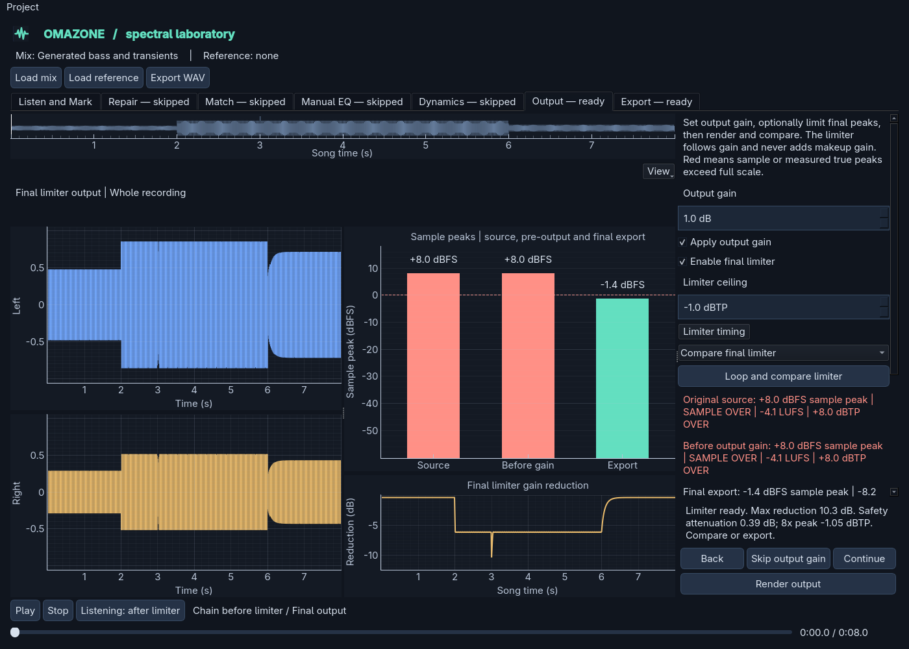

# Final output limiter

The optional limiter follows explicit output gain. It controls new output peaks;
it does not repair clipping already present in a recording.



```text
Original -> repair -> matching -> manual EQ -> compression -> output gain -> limiter -> export
```

## Using it

1. Open **Output** and review the source, before-gain and final measurements.
2. Check **Enable final limiter**. Start with the default **-1 dBTP** ceiling.
   Output gain and limiting have independent bypass switches.
   **Skip output gain** leaves an enabled limiter in place and stays on Output
   so you can render its changed input.
3. **Limiter timing** exposes lookahead and release. Defaults are 5 ms and 100 ms.
4. Click **Render output**. The whole song is rendered, even with a selection.
   An animated activity bar and elapsed time remain visible above the settings.
5. Choose **Compare final limiter** and click **Loop and compare limiter**.
   Before is the chain after output gain; After adds only the limiter.
   **Compare output gain** excludes the limiter on both sides.
6. Review the gain-reduction trace, final measurements and safety-attenuation
   readout, then export. A heavy reduction calls for listening, not just checking
   that the peaks fit.

There is no automatic makeup gain or loudness target. The limiter never boosts
the signal, changes the output-gain setting or overwrites its input. Bypassing it
retains its settings and restores the signal after output gain. Old projects load
with limiting disabled.

## Lookahead and stereo linking

The native-rate block processor measures the largest absolute channel sample.
It derives an attenuation-only gain, holds it for one lookahead window and
smooths it over another with a moving average. Both channels receive exactly
the same gain. Release is an exponential recovery of the linear gain reduction.

Holding the required gain before averaging makes the smoothed envelope safe at
the corresponding delayed sample. A transient can start reducing gain before
it reaches the output rather than requiring an instantaneous gain cut there.
The processor does not hard-clip individual samples.

Audio delay is `max(1, round(sample_rate * lookahead_ms / 1000))` samples.
The saved recipe stores lookahead in milliseconds; the actual delay is derived
from the recording's sample rate and shown after rendering. File rendering feeds
zeroes through the delayed tail, removes the initial delay and retains exactly
the original length. A/B pairs and reduction timestamps use that compensated
timeline. There is no appended tail or shifted comparison.

## Reconstructed-peak safety check

A sample ceiling alone cannot protect an inter-sample peak. After native-rate
limiting, the offline renderer checks the reconstructed waveform at 8x with a
Kaiser-windowed polyphase interpolator. Overlapping chunks bound working memory;
file-edge samples and short recordings are included. A second, longer
reflect-padded edge reconstruction catches ringing predicted by decoder
resamplers that do not pad the file with silence. The guard uses the larger peak.

If that check approaches or exceeds the ceiling, the renderer attenuates the
whole limited file to leave **0.05 dB** of margin. This is a fixed, attenuation-only
safety correction, not loudness normalisation. It can lower quieter passages too.
The Output summary reports its amount separately, and the gain-reduction trace
includes it. Original samples and explicit output-gain choices remain unchanged.
If the reconstructed peaks are already below the protected ceiling, this pass
does nothing.

The summary's **8x verified peak** is this protection measurement. The standard
Output rows still use the existing 4x display meter, which omits readings for
silence and very short files. Slight differences between meters are expected.
The ceiling applies to this documented reconstruction method, not every possible
converter, lossy codec or resampling filter. Leave delivery headroom and check any
later encoded version separately.

## Recipe, caches and verification

The independently bypassable stage saves a versioned recipe:

```json
{"kind": "limiter-v1", "ceiling_db": -1.0, "lookahead_ms": 5.0, "release_ms": 100.0}
```

Changing these settings invalidates the limiter and export, not matching,
compression or output-gain A/B. Changing output gain invalidates both gain and
limiting. Unknown limiter recipes remain intact while bypassed; enabling one
blocks rendering and routes export review back to Output.

Tests cover single-sample transients, reconstructed overshoots, bass, stereo
linking, silence, short files, endpoint retention, reset, irregular block sizes,
aligned diagnostics, saved recipes, old-project migration, prefix reuse and
float-WAV export. Sample-ceiling tolerance is **1e-12 relative**. A separately
rendered 16x reference must stay within **0.05 dB above the ceiling** on the test
signals. An optional independent FFmpeg EBU R128 true-peak check meters the
exported float WAV with a **0.1 dB tolerance**, including its rounded display.

The tests verify numerical behaviour. Listen on real mixes for pumping, bass
distortion, softened attacks and stereo changes before relying on a setting.
