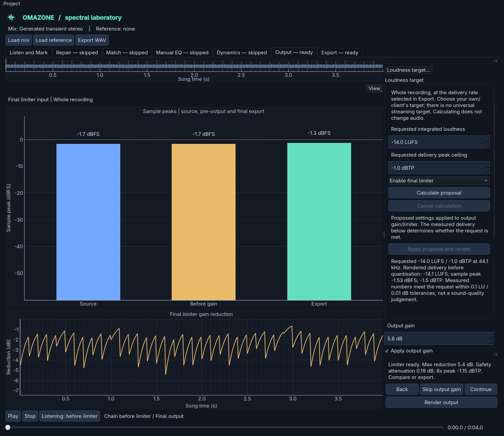
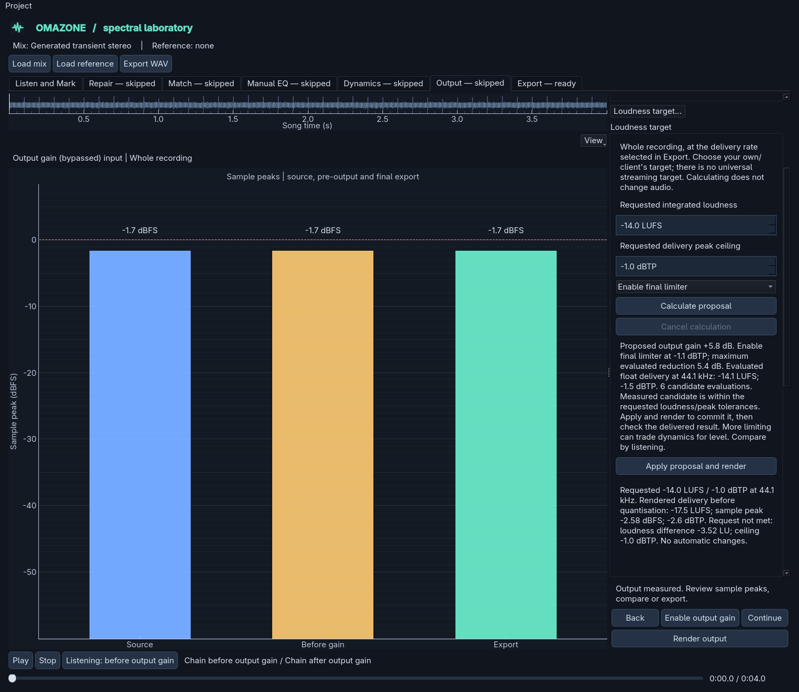

# Explicit loudness targeting

In **Output**, expand **Loudness target...**. Set a requested integrated LUFS and
delivery peak ceiling, then choose **Calculate proposal**. Calculation does not
change processing, audition or export. **Apply proposal and render** is a separate
decision that updates the existing output gain and final limiter controls.

There is no universal streaming mastering target. The initial -14 LUFS / -1 dBTP
values are editable examples, not platform requirements or a sound-quality score.
Use your own or your client's specification. More limiting can trade dynamics
and transient shape for level. Numerical agreement is not evidence of better sound.

## Workflow

1. Render the current full chain. Targeting uses the signal **before output gain
   and limiting**, retaining repairs, learned matching, EQ and compression.
2. Choose the delivery rate in **Export** if it differs from the source. The
   targeting panel identifies that rate; it does not change audition's rate.
3. Enter requested LUFS and peak ceiling. The scope is always the whole recording,
   even if a passage is selected for audition or metering elsewhere.
4. Choose a proposal policy:
   - **Gain only, limiter off** preserves dynamics. It proposes output gain capped
     by the delivery peak ceiling and format headroom. Applying this policy
     bypasses an enabled limiter but retains its saved settings.
   - **Enable final limiter** intentionally proposes use of the existing limiter
     after output gain. Its lookahead/release choices are retained. Any proposed
     change to its source-rate ceiling is shown before Apply.
5. Calculate and inspect the proposed gain, limiter state/ceiling, evaluated
   limiter reduction, delivery-rate LUFS/true peak, and outcome explanation.
6. Apply only if wanted, then inspect **Rendered delivery before quantisation**.
   Rendered measurements, not the earlier proposal or an estimated LUFS gain
   offset, determine whether the current numbers meet the request.
7. Compare the correct stage at matched loudness, inspect limiter reduction and
   listen on transient-heavy and sustained passages before exporting. Export's
   **Last written file** and the targeting panel also compare the actual file
   measurements with the request, including any export-only attenuation/dither.

Gain-only A/B may sound identical because audition matches levels. That is normal:
this operation changes delivery level, not tonal balance. Preview matching is never
exported. Applying limiter mode selects limiter-only A/B; applying gain-only mode
selects output-gain A/B. The original recording remains available separately.

## Unattainable and undefined results

If peak-safe gain cannot reach the target, the request stays unchanged and the
measured quieter result is shown. An unmet proposal requires an additional
confirmation before Apply. A gain bound or the finite search can also prevent
reaching a request; the UI states that rather than calling the closest candidate
a success. A result with no evaluated peak-safe candidate cannot be applied.

The request range is -60 to 0 LUFS and -24 to 0 dBTP. Proposals stay within the
existing output gain range of -36 to +18 dB and limiter ceiling range of -24 to
0 dBTP, using the controls' 0.1 dB resolution. Higher-precision loaded request
values are retained until explicitly edited.

There must be at least one complete 400 ms loudness block at the delivery rate,
with enough energy to survive the existing BS.1770 absolute/relative gates. Silence,
below-gate and shorter material has no valid baseline loudness. It generates no
arbitrary gain, infinity or fabricated target success. See [loudness](loudness.md).

Success means integrated loudness is within **0.1 LU** of the request and measured
true peak is no more than **0.01 dB** above the ceiling, with format headroom also
checked for proposals. The raw sample peak must also respect the ceiling: a loud
file-edge sample cannot be hidden by the true-peak meter's edge trimming.
Peak figures remain oversampled estimates. These tolerances
do not guarantee every converter's playback or a later lossy encode.

## Evaluation policy, version 1

- Measure the pre-output baseline at the chosen delivery rate. Reuse the current
  renderer's scalar pre-output readings when source and delivery rates agree.
- Start with `requested LUFS - baseline LUFS` as the gain estimate. It is not the
  final loudness prediction; gated loudness can change nonlinearly after scaling.
- For gain-only mode, cap gain using reconstructed peak and the selected format's
  sample/dither headroom. A small numerical margin and rounding down keep the
  proposed settings inside that cap.
- Each candidate is evaluated on audio at the selected delivery rate. Gain-only
  mode scales converted blocks, since static gain commutes with linear conversion,
  and recomputes the loudness gates. Limiter mode renders the existing source-rate
  limiter, then converts and measures its result. The actual committed render
  applies output gain before the limiter/converter and is checked again.
- Limiter mode starts with a slightly lower source-rate ceiling to leave delivery
  headroom. If conversion still overshoots, a lower existing-limiter ceiling is
  proposed and measured. There is no hidden post-conversion limiter or gain stage.
- Candidate gain corrections are limited to 6 dB per evaluation and rounded to
  the existing controls' resolution. At most **six candidates** are evaluated,
  with no repeated identical setting pair. This is a bounded search, not a proof
  of a globally optimal or attainable loudness.
- Retain only the closest evaluated peak-safe candidate. Nonconvergence, undefined
  readings and bounds remain explicit. No random processing or platform presets
  are used. Repeating identical requests/settings is deterministic.

Calculations run in a worker with progress messages and cancellation checks between
bounded meter, conversion and limiter blocks. Changing the requested target,
delivery settings, output choices or rendered input invalidates an old proposal;
late/cancelled results cannot restore its Apply action. Closing waits for a
cancelled worker to stop. Upstream processing can still be edited, but doing so
requires a new full render before recalculating.

Limiter evaluations can need a full-length gain buffer and limiter result in
addition to the existing chain. Only one candidate's audio is evaluated at a time;
the proposal retains scalar results, not six audio renders. Converted metering
remains block-based without an extra full-track converted buffer. A long recording
may require several offline passes, especially with a different delivery rate.

## Projects, bypass and export

Requests are stored as optional `loudness-target-v1` view/working preferences,
separate from processing-stage parameters. Old projects acquire no automatic gain,
limiting or targeting operation. Loading a project restores its explicit committed
output settings and request, but never recalculates or applies a proposal on its own.

Apply commits ordinary `output-gain-v1` / `limiter-v1` parameters. Bypassing either
stage retains those choices; saved-recipe rendering reuses learned matching and
upstream prefixes. There is no new stage or export normalisation hidden in the
recipe. Editing a target alone does not make the rendered audio stale.

The rendered-delivery result is float audio before quantisation. The written-file
result includes final float/PCM quantisation, dither and any separately consented
delivery attenuation. A quieter export may therefore miss a target that its render
met; the panel says so instead of preserving a false success indication. See
[delivery](delivery.md) and [sample-rate conversion](sample-rate-conversion.md).

Tests cover attainable gain-only targets, peak-constrained shortfalls, intentional
limiting on transients, converted outcomes, undefined loudness, cancellation,
nonconvergence, recipe replay and stage A/B. Real-music listening still matters,
especially when the limiter is working hard. Report audible pumping or transient
damage alongside settings and timestamps, not just whether the meters match.

Recreate the screenshots with
`uv run python tools/render_loudness_target_demo.py docs/images`.
