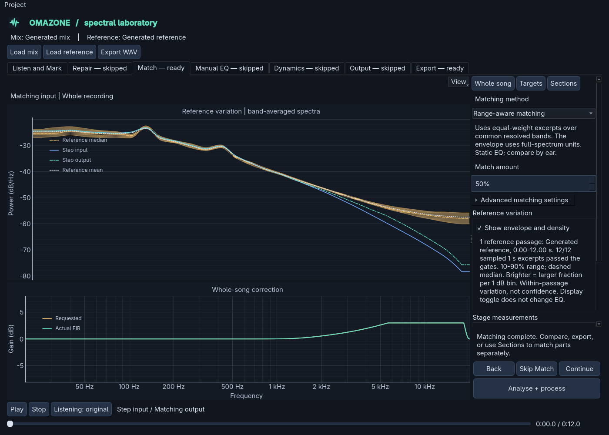

# Range-aware matching

**Matching method** offers **Reference EQ matching** and **Range-aware matching**
on Match's Whole song page, and independently for each section. Ordinary
average-spectrum matching remains the default. Neither method is a judgement of
musical quality or a substitute for listening.

## Try it

1. Load a mix and a reference. Both need at least four full seconds of usable
   audio for range-aware analysis. Comparable passages are preferable to an intro
   and chorus pooled together.
2. Choose **Range-aware matching**. Start with a modest amount and correction
   limits. Existing envelope-only targets need reloading or recapturing because
   their quantiles alone cannot supply the new normalisation.
3. Optionally expand **Advanced matching settings** and choose **Inspect proposed
   curve**. This calculates and plots a filter without rendering audio, changing
   saved calibration or making export ready.
4. Choose **Analyse + process**, then compare by listening. The lower plot shows
   requested gain and the actual designed FIR response separately. Stage
   measurements report raw input/output, not audition gain matching.
5. Save the project to retain the selected method, reference excerpt data and
   learned filter. Downstream processing edits still render the saved filter,
   rather than learning another match.

For section matching, choose the method in that section's form, then Add/Update
and **Render sections**. **Inspect EQ** calculates that section's proposed curve.
Each section uses its own source passage and target; the transition/render path
is unchanged. Other sections may keep ordinary matching.

## What version 1 compares

Reference EQ matching compares the existing time-averaged power spectra.
Range-aware matching instead compares equally weighted one-second excerpts from
both sides. A static EQ shifts tonal shape; it does not independently change a
band's temporal spread or reshape the reference distribution.

1. Use the reference's measured band grid, approximately three bands per octave.
   Analyse source excerpts on that same grid using the existing variation Welch
   policy. Keep the four-excerpt minimum, absolute/relative energy gates, 4096
   observation cap and deterministic evenly spaced sampling.
2. Select complete reference-grid bands below both recordings' Nyquist limits,
   resolved by both FFTs. At least four such bands are required. No resampling of
   either recording is involved.
3. Re-normalise **each excerpt** to unit power integrated over those common bands,
   including bandwidth in the integration. Take quantiles only after this step.
   Thus energy outside the common domain does not introduce a constant relative
   level offset. Excerpts with no above-floor common-domain observations are
   excluded, and each side still needs at least four accepted excerpts.
4. A correction band needs at least four usable observations and 80% coverage on
   each side. Censored observations at or below the original -120 dB/Hz floor
   are excluded. Also exclude densities more than 60 dB below that excerpt's
   strongest common band to avoid boosting effectively empty tails. This cannot
   distinguish quiet music from noise and is not source separation.
5. Calculate the source median and the reference's empirical 10th/90th percentiles
   from each supported band's usable observations. If `S` is that source median,
   request `clip(S, L, U) - S`. Inside the range, the unsmoothed request is zero;
   outside it, request the nearest boundary, not the reference median.
6. Interpolate band requests onto a logarithmic design grid, anchored to zero
   outside the analysed centres. Apply the selected octave smoothing, zero
   unsupported bands, apply amount and the boost/cut limits, then design the
   same linear-phase FIR used by ordinary matching. Supported runs have a
   raised-cosine taper to zero at their outer band edges, over up to 1/6 octave,
   even when octave smoothing is zero. This avoids hard jumps beside missing
   bands. DC and Nyquist remain unity
   in the requested curve.

Smoothing, normalisation and finite FIR resolution couple frequencies. An
in-range band is not guaranteed to remain sample-for-sample unchanged, and the
realised response may differ from the request. Rendered output is measured and
must be auditioned. Repeating an analysis is deterministic, not a new random EQ.

## The envelope is still a display

The [reference envelope](reference-variation.md) is available in both methods.
Its curves retain their full-spectrum relative dB/Hz units, and its source/output
overlays are average spectra, not the excerpt medians used by this method.
It is not a plot of the correction algorithm's common-domain statistics.
Do not expect the output line to be forced inside the visual envelope.

The method's normalisation is explained beside its selector. Changing the
envelope toggle or its visual interpolation never changes matching or export.
The envelope describes variation within one passage, not independent reference
songs, uncertainty or a confidence interval. Broad or heterogeneous references
can give a permissive range and little correction; that is not a quality verdict.

## Profiles, recipes and limits

New reference captures retain `reference-variation-v2` data. The calculation of
the displayed envelope is unchanged from v1; v2 additionally stores the accepted
excerpt-by-band relative log-power observations. This preserves cross-frequency
relationships needed to re-normalise each excerpt over a common domain. It stores
neither audio samples nor FFT frames. At most 4096 by 29 float values add about
0.91 MiB in memory per profile, plus JSON representation on disk.

V1 variation profiles keep their existing display and ordinary matching result.
Mean-only targets remain usable too. Neither is silently converted into excerpt
observations. Reloading the recording or capturing a new target supplies v2 data.
Unsupported policies and inconsistent observations/counts/quantiles are rejected.

The matching method identifier `range-aware-v1` fixes the correction policy above.
Range-aware calibration signatures include the retained observations and band
grid. Ordinary matching signatures retain their legacy representation, so adding
the feature does not invalidate previously learned ordinary matching filters.

Analysis and proposed-curve calculation use existing workers, not the audio or GUI
thread. Reference observations are retained in the profile rather than repeatedly
analysing its audio; source excerpts are recomputed on explicit analysis. Saved
recipe replay uses the learned FIR without running either analysis again.

No bootstrap stability estimate, multiple-reference pooling, automatic target
selection, upward/dynamic spectral processing or claim of better sound is included.
Numerical tests cover neutrality, broad-imbalance correction, sample-rate/bandwidth
differences, repeatability and recipe replay. Real-music, level-matched comparison
of both methods is still needed before treating the new method as validated for
your material. Record poor results as well as useful ones.
