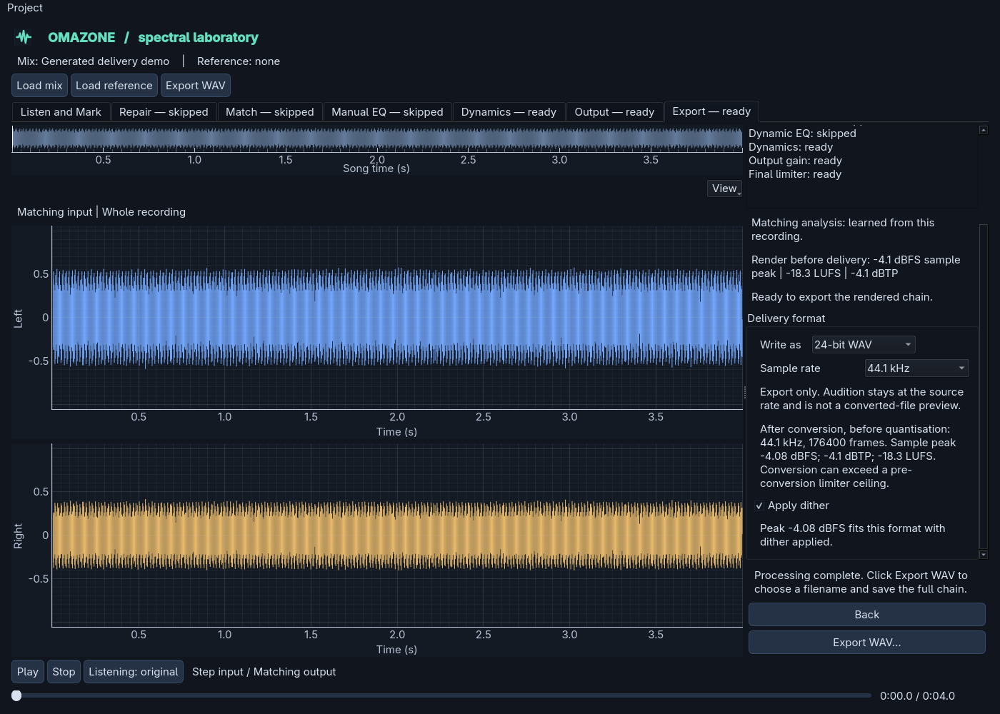

# Export sample-rate conversion

In **Export → Delivery format → Sample rate**, keep **Source rate** or choose
44.1, 48, 88.2 or 96 kHz. Format still defaults to 32-bit float; 24-bit PCM still
has default-enabled TPDF dither. Conversion runs on the full rendered chain,
before export-only attenuation, final quantisation and dither.

Processing and audition stay at the source rate. The app's playback is **not a
converted-file preview**. Open the exported file in a suitable player or a new
session to listen to that deliverable. Device selection never silently resamples
playback or falls back to another device.

## Supported rates and duration

Conversion accepts source rates of 8, 11.025, 12, 16, 22.05, 24, 32, 44.1, 48, 64,
88.2, 96, 176.4 and 192 kHz, in mono or stereo. Destination choices are 44.1, 48,
88.2 and 96 kHz. For other source rates, source-rate export remains available;
an unsupported conversion is refused, not silently replaced with a different rate.

Choosing the source rate is a true bypass. No converter runs and the samples
before optional delivery gain/quantisation remain unchanged. Existing same-rate
PCM codes and float sample behaviour are preserved.

For conversion, the output contains
`ceil(input_frames × output_rate / input_rate)` frames. Duration differs by less
than one output sample. The symmetric conversion filter's delay is compensated;
channels share the same filter and sample positions. Zero padding defines the
finite recording's edges. Edge transients/ringing can change peaks, even for a
constant-level signal; they are included in sample/headroom checks.

## Measurements and consent

The Export panel measures the converted float audio in a worker before allowing
export. It shows the destination rate, frame count, sample peak, oversampled true
peak and gated integrated LUFS. Silence and short material have absent readings
where the existing meters are undefined, not invented loudness or true peaks.
The source-rate Output panel remains labelled **Render before delivery** on the
Export page; it is not substituted for converted measurements.

The review cache holds only scalar readings and a weak reference to the rendered
audio. Format/dither changes reuse those readings. Rate or render changes
invalidate them. Cancelled or stale workers cannot restore old results. Failed
measurements disable delivery at that rate rather than falling back to source-rate
numbers.

Resampling can introduce sample or reconstructed peaks above a pre-conversion
limiter ceiling. There is no extra automatic limiter or hidden gain change.

- If converted samples do not fit 24-bit PCM including dither headroom, the
  existing attenuation-or-cancel dialog uses the **converted** sample peak.
- If converted true peak exceeds 0 dBTP, or the earlier enabled limiter's ceiling,
  export asks whether to continue without further level changes or cancel and
  adjust the processing. Cancel is the default and Escape action. A short file
  with no true-peak reading can still trigger a warning from its known sample peak.
- Writing independently rechecks converted sample headroom. Success reports
  sample peak, true peak and LUFS of the actual written sample values in the
  **Last written file** readout, including
  consented attenuation and final float/PCM quantisation. LUFS is remeasured rather
  than estimated by adding the requested gain to an earlier reading.

The float review and actual file readings can differ slightly after quantisation,
and deliberately differ after consented attenuation. True peak remains an
oversampled estimate, not a promise about every converter or later lossy encode.

## Converter choice and numerical policy

This implementation uses SciPy's rational polyphase FIR path, `resample_poly`,
with an explicitly designed filter rather than its default short filter.
SciPy is already bundled under its BSD-3-Clause licence and is compatible with
Omazone's GPLv3 distribution. A separately packaged SoXR binding was an
alternative, but would add compiled dependency, packaging and licensing-review
work. We chose a testable existing dependency, not a claim of audible superiority
over other converters.

For reduced ratio `up/down`, the filter has `256 × max(up, down) + 1` taps, a
Kaiser window with beta 14, and cutoff `0.95 / max(up, down)` in high-rate Nyquist
units. The intended passband is through 90% of the lower Nyquist frequency,
with less than 0.001 dB amplitude error. Tests probe downsampling rejection beyond
destination Nyquist and the first upsampling image, requiring more than 110 dB
rejection. The upper transition band is deliberately not described as flat.

Tests compare every supported rate pair against a monolithic calculation using
the same filter, including irregular block sizes, DC, impulses and stereo polarity.
That comparison verifies chunking and alignment, not an independent proof of
sound quality. Spectral probes provide separate passband/rejection checks.

Core input and output blocks are limited to approximately 65536 frames. Context
contains the full FIR support; block origins align to the reduced denominator so
the polyphase phase is identical to processing the entire recording. No extra
full-track converted buffer is allocated. Streaming K-weighting retains filter
state and overlapping energy windows; true-peak measurement retains real context
and trims only unsettled file edges according to the existing meter policy.

At most four conversion filters are cached. Review converts once for measurements;
writing converts again to independently validate headroom, then converts in blocks
for the atomic output. This trades repeated offline computation for bounded memory
and avoids retaining a second full master. Dither runs once, after conversion,
with one generator for the file.

A local generated six-minute constant stereo probe at 48 → 44.1 kHz took about
15.5 seconds for conversion plus all review meters, with about 12.4 MiB peak
tracked allocations above the source. A six-second probe used about 12.5 MiB.
These are development measurements, not a performance guarantee or a listening
test. There is no converted audio processing on the GUI/audio thread.

The destination is atomically replaced only after conversion, quantisation,
writing and final metering succeed. Failures remove the temporary output and
leave an existing destination intact. Saving repaired source audio remains a
separate, source-rate 64-bit float archival operation.
