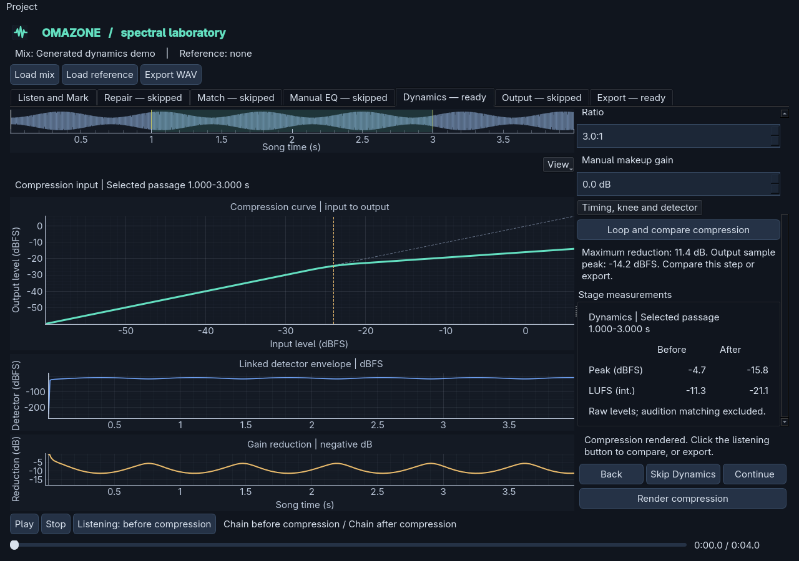

# Before/after stage measurements

Each processing inspector has a **Stage measurements** panel below its settings.
It follows that inspector's A/B comparison: Repair, Matching, Manual EQ,
Corrective filters, Dynamic EQ, Dynamics, Output gain or Final limiter. On Output, use the
comparison selector to choose gain or limiter. The panel names the comparison
and the scope it measures.

## Readings

- **Peak (dBFS)** is the largest absolute sample across all channels, expressed
  relative to full scale. Positive readings are possible in float audio.
  This is sample peak, not oversampled true peak.
- **LUFS (int.)** is BS.1770-4 gated integrated loudness. See
  [the loudness meter](loudness.md) for details of K-weighting and gating.

With no passage selected, both columns describe the whole recording. Selecting
a passage measures precisely those sample bounds on both sides. The scope label
shows its start and end times. This does not restrict processing to that passage
or change what is exported. The passage is metered independently, including its
own K-weighting filter startup and gates, rather than averaging whole-song LUFS.

Readings use the raw stage input and output. Preview loudness matching,
playback fades, device selection and export-only attenuation/dither do not enter
these measurements. Changing the audition side does not change the readings.
Band solo is explicitly audition-only; exit solo to measure full compression.

## Missing and stale readings

`--` means a reading is unavailable, not zero. Exact silence has a sample peak
of `-inf` dBFS and no LUFS. Non-silent passages shorter than 400 ms also have no
integrated LUFS; material below the loudness gate is labelled separately.

Editing settings clears the obsolete output column immediately. The input can
remain measured if it is still current. If an upstream stage needs rendering,
neither column is presented as that downstream stage's current boundary, even
when the viewer retains an earlier signal for context. Render or resolve the
upstream stages first. Late results from an old selection or recipe are ignored.

Skipped stages are labelled. A rendered bypass has equal input/output readings;
before rendering, the absent comparison is left blank. Repair can retain an
auditionable preview while skipped in the chain; its readings are explicitly
labelled as preview readings rather than delivered processing.

## Performance and saved projects

Peak scans and LUFS run in a separate worker, not in the audio callback or UI
thread. Whole-recording LUFS reuses the render worker's prefix readings when
available. A bounded cache reuses unchanged array/rate/passage measurements and
holds only scalars and weak references, not old song buffers. Rapid changes keep
only the latest pending request. LUFS still needs temporary filtering memory
while a job runs; the cache does not remove that processing cost.

Measurements are read-only. They add no processing stage or saved recipe fields,
do not adjust gain automatically, and do not add per-stage true-peak oversampling.
The panel scrolls with settings, leaving the song viewer and primary actions
their existing space.
